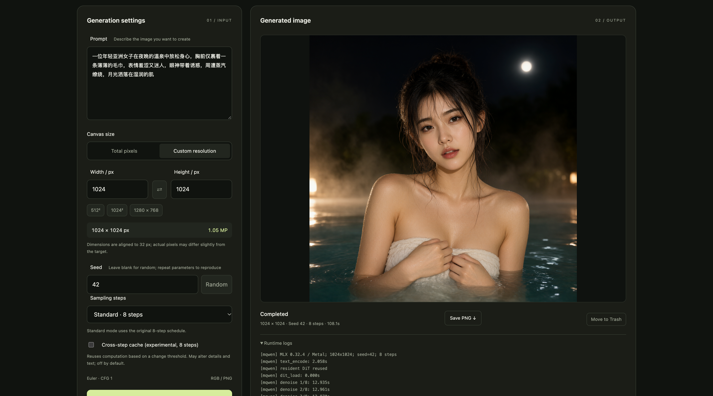

# MQwen · Qwen-Image 2.1 Turbo for Mac

**中文** · [English](README.en.md)

Apple Silicon 本地影像工作室：桌面 App、WebUI、CLI 和生图 API。文本编码、DiT 去噪与 VAE 解码使用 **MLX / Metal**，复用已有 ComfyUI INT8 ConvRot 权重，推理不依赖 ComfyUI 或 PyTorch。

## 生成与编辑

- **文生图 / 透明图层**：选择 RGB 或 RGBA；生成透明背景时，在提示词中明确说明。
- **多图参考编辑**：选择“参考图编辑”，上传原图及参考图（最多 10 张），用 `<image1>`、`<image2>` 引用。
- **局部修改**：在原图上涂绘或上传灰度蒙版；白色修改，黑色保留，最终合成保留蒙版外像素。
- **移除背景 / 特征保留**：提供背景移除任务及人物、商品保留指令按钮；实际保真取决于模型。RGBA 导出为单张透明图，不包含自动多层分解。

模型能力、较小 VAE、权重取舍和编辑 API 见 [功能与模型说明](docs/CAPABILITIES_AND_MODELS.zh-CN.md)。编辑沿用现有三份权重，首次按需加载视觉塔，所需内存和时间高于普通文生图。

## 下载与安装

从 [Releases](https://github.com/jinjun1994/Qwen-Image-2.1-Turbo-Mac/releases) 下载 `MQwen-0.5.0-arm64.dmg`，打开后将 `MQwen.app` 拖到 Applications。桌面版内置 Python 与运行依赖，**不包含模型权重**。

- **要求**：Apple Silicon、macOS 26+；已验证 M3 Pro / 36GB / macOS 26.3。其他配置尚未实测，不能将权重大小当作全部内存需求。
- **签名**：当前为 ad-hoc 签名测试版，尚未经过 Apple Developer ID 签名或公证，其他 Mac 可能受 Gatekeeper 阻止。
- **隐私**：提示词与图像在本机处理；下载模型时才主动连接所选公开源。无遥测或云端推理。

### 首次打开：允许 MQwen 运行

如果首次打开提示“无法验证开发者”或“Apple 无法检查 App 是否包含恶意软件”，确认文件来自本仓库的 Releases 后，按以下步骤允许这个 App：

1. 在“应用程序”中双击 `MQwen.app`；出现拦截提示时，点击“完成”或“取消”。
2. 打开 ** → 系统设置 → 隐私与安全性**，向下滚动到 **安全性**。
3. 找到 MQwen 被阻止打开的提示，点击 **仍要打开（Open Anyway）**。
4. 按提示使用 Touch ID 或管理员密码验证，在再次出现的确认框中点击 **打开**。以后通常可直接双击启动。

若没有看到“仍要打开”，先再次尝试启动 MQwen，再返回上述设置页面。此操作只允许所选 App，无需全局关闭 Gatekeeper。若提示“将损坏你的电脑”或文件已损坏，请先重新下载并核对 Release 的 SHA-256，或从源码构建。

步骤依据 [Apple 官方说明](https://support.apple.com/zh-cn/102445)，也参考了开源播放器 [IINA 的安装 FAQ](https://github.com/iina/iina/wiki/FAQ)。

## 开始生图

1. 打开 MQwen（默认英文，右上角 **English / 中文** 可切换并记住选择；桌面工具栏与内嵌界面同步）。顶部控制 **WebUI / API 整体服务**，默认地址 `http://127.0.0.1:7861`。端口占用时可修改。
2. 点击 **Models & API（模型与 API）**，分别选择 Turbo DiT、文本编码器和 VAE，保存路径。
3. 点击 **Start inference（启动推理服务）**，等待模型加载完成。
4. 输入提示词，或点击 **Random prompt（随机提示词）** 从六条内置原文中随机填入（不自动生图，也不随界面语言翻译），再设置总像素 / 分辨率、宽高比和种子。建议先用 **512×512、标准 8 步、关闭跨步缓存**。
5. 点击生成；支持预览、取消、历史作品和保存 PNG。最近作品中的 **Move to Trash（移到废纸篓）** 会在确认后，将 PNG 与参数 JSON 一起移入系统废纸篓；可从废纸篓恢复，正在生成的作品不可删除。废纸篓中的 `MQwen-deleted-…` 文件夹保留这两个文件；需要恢复到作品列表时，将文件放回输出目录并重启 WebUI/API。图片及参数 JSON 位于 `~/Pictures/MQwen/`。

模型保持常驻，直到关闭推理服务。页面中的“关闭推理服务”只释放模型；桌面顶部“关闭 WebUI / API”停止整个 HTTP 服务并释放模型。退出 App 会关闭它自己启动的服务；生成中关闭需要等待当前 GPU 操作结束。

独立 WebUI 的语言选择保存在当前浏览器中；桌面版保存在 App 设置中，重启后保持。切换不会清空提示词、尺寸或未保存的模型路径，也不会重载模型。系统文件对话框遵循 macOS 自身语言；技术诊断日志保留原文。

设置：`~/Library/Application Support/MQwen/settings.json`；日志：同目录 `server.log`。

## 模型路径与下载

可直接选择已有 ComfyUI 文件，不复制、不修改原模型。当前适配以下组合，**不支持任意 GGUF、FP8、INT4 或其他模型**：

| 组件 | 文件名 |
| --- | --- |
| Turbo DiT | `qwen_image_2.1_turbo_int8_convrot.safetensors` |
| 文本编码器 | `qwen3vl_8b_int8_convrot.safetensors` |
| VAE | `qwen_image_2.1_vae_bf16.safetensors` |

**Models & API → Download models（模型与 API → 从公开源下载模型）** 支持：

- **Hugging Face**：[Comfy-Org/Qwen-Image-2.1](https://huggingface.co/Comfy-Org/Qwen-Image-2.1)，内置固定版本与 SHA-256。
- **ModelScope / 其他公开源**：填写文件的公开 HTTPS 直链及发布者 SHA-256；无内置未经核验的镜像或登录管理。

三个文件合计约 **17.28GB**，另需转换缓存及输出空间。支持串行下载、进度、取消、断点续传和 SHA-256 校验，不覆盖已有模型。下载完成后点击“使用已下载模型”，保存路径，再启动推理服务。修改路径前需停止推理服务。模型许可独立于本项目 MIT 许可。

## 性能

以下为 0.3.0 的实测记录；0.4.0 沿用相同推理数学。**M3 Pro / 36GB、macOS 26.3、交流电、512×512、标准 8 步、关闭近似缓存**；模型常驻，示例茶壶提示词、seed 42。

| 路径 | 完整生图耗时 |
| --- | ---: |
| ComfyUI（用户提供，非同条件复测） | 约 90s |
| MQwen 桌面版：引擎加载后首张 | 24.431s |
| MQwen 桌面版：热请求 | 23.669s / 23.486s |

**交流电实测约 24 秒出图**，热请求中位数 **23.578s**。相对用户提供的 90s 粗略约 **3.8 倍速度、少 74% 时间**。耗时包含文本编码、去噪、VAE 与保存，启动加载另计；热请求复用相同提示词和形状。三轮输出均与本项目标准参考逐像素一致。

这是实测参考，不是固定耗时保证，也不是严格同条件 ComfyUI A/B。提示词、芯片、温度和后台负载会影响速度；不同框架相同 seed 不保证同图。详见[基准记录](docs/benchmarks/desktop-ac.json)及[性能优化与实验记录](docs/PERFORMANCE_NOTES.zh-CN.md)。

## 从源码运行

需要 Apple Silicon、Python 3.13 和 [uv](https://docs.astral.sh/uv/)。

```sh
git clone https://github.com/jinjun1994/Qwen-Image-2.1-Turbo-Mac.git
cd Qwen-Image-2.1-Turbo-Mac
./scripts/setup.sh

# 带模型设置与下载的 WebUI；手动启动推理服务
.venv/bin/mqwen web --desktop --no-auto-start
```

浏览器打开 `http://127.0.0.1:7860`，Ctrl+C 退出。CLI 默认输出到当前目录 `outputs/`，可用 `--output-dir` 修改。

将模型按上述文件名放入 `~/MQwen/models/{diffusion_models,text_encoders,vae}/` 后，可直接生成：

```sh
.venv/bin/mqwen generate \
  --models "$HOME/MQwen/models" \
  --prompt 'A small red ceramic teapot on a wooden table, morning sunlight.' \
  --seed 42 --width 512 --height 512 --steps 8 \
  --output outputs/teapot.png
```

也可用 `--dit`、`--text-encoder`、`--vae` 指定单独文件，`--extra-models` 添加搜索目录。模型不会自动下载；输出 PNG 和同名 JSON 必须不存在。详见 `mqwen generate --help` / `mqwen web --help`。

## 本地生图 API

桌面版默认端口 **7861**，CLI WebUI 默认 **7860**。仅监听 `127.0.0.1`，共用单任务常驻引擎，不提供公网服务或 OpenAI 协议兼容。

```sh
curl http://127.0.0.1:7861/api/engine/start \
  -H 'Content-Type: application/json' -d '{}'
# GET /api/state，等待 engine_state 为 ready

curl http://127.0.0.1:7861/api/generate \
  -H 'Content-Type: application/json' \
  -d '{"prompt":"a red ceramic teapot","mode":"resolution","width":512,"height":512,"seed":"42","steps":8,"step_cache":false}'

curl http://127.0.0.1:7861/api/state
# 按返回的任务 id 查询；完成后使用 image_url / metadata_url
curl http://127.0.0.1:7861/image/JOB_ID -o result.png
```

| 接口 | 作用 |
| --- | --- |
| `GET /api/health`、`/api/state` | HTTP 身份、引擎状态、任务进度和结果 |
| `POST /api/generate`、`/api/cancel` | 创建 / 取消任务；未就绪或忙返回 409，参数错误返回 400 |
| `POST /api/engine/start`、`/api/engine/stop` | 加载 / 释放常驻模型，JSON 请求体为 `{}` |
| `POST /api/jobs/{id}/delete` | 将已完成作品的 PNG / JSON 一起移到系统废纸篓 |
| `GET /image/{id}`、`/metadata/{id}` | 已完成任务的 PNG / 参数 JSON |
| `GET/POST /api/settings` | 桌面模式模型设置；修改要求推理服务已停止 |
| `GET /api/downloads` | 模型目录与下载任务状态 |
| `POST /api/downloads/start`、`/api/downloads/cancel` | 下载 / 取消；启动传入 `role`、`source`，自定义源另含 `url`、`sha256` |

所有 POST 使用 `application/json`。`seed` 为十进制字符串；`mode:"pixels"` 可用 `megapixels:0.25, ratio:"1:1"` 替代宽高。

## 限制

- 当前推荐 512×512。近期 1024×1024 完整 VAE 解码遇到 GPU OOM；2048 分辨率尚未实机验证。
- 6/4 步与跨步缓存为可选实验，会改变输出；标准 8 步及关闭跨步缓存为默认设置。
- 尚不支持图像编辑、LoRA、RGBA 或任意模型架构；未完成官方 BF16 逐层误差与大规模画质对照。
- 常驻不代表锁定所有物理页；不承诺零分配、GPU 零拷贝或 ICB 重放。

## 开发与开源

```sh
.venv/bin/python -m unittest discover -s tests -v
uv pip install --python .venv/bin/python pyinstaller==6.22.3
./scripts/build_desktop.sh
```

桌面构建需要 Command Line Tools、Swift、`hdiutil` 与 `iconutil`，输出 App、DMG 和 SHA-256。详见 [desktop/README.md](desktop/README.md)。核心实现位于 `src/mqwen/`，桌面壳为 AppKit / WKWebView，推理组件复用 MFLUX 0.23.0 与 MLX 0.32.4。

项目代码采用 [MIT License](LICENSE)，第三方派生文件、tokenizer 和模型保留各自许可，见 [THIRD_PARTY.md](THIRD_PARTY.md)。本项目不是 Qwen、Apple 或 MFLUX 的官方产品，不分发模型权重。提交问题时请附芯片、内存、系统版本、参数及日志，并移除私人提示词和本机路径。
